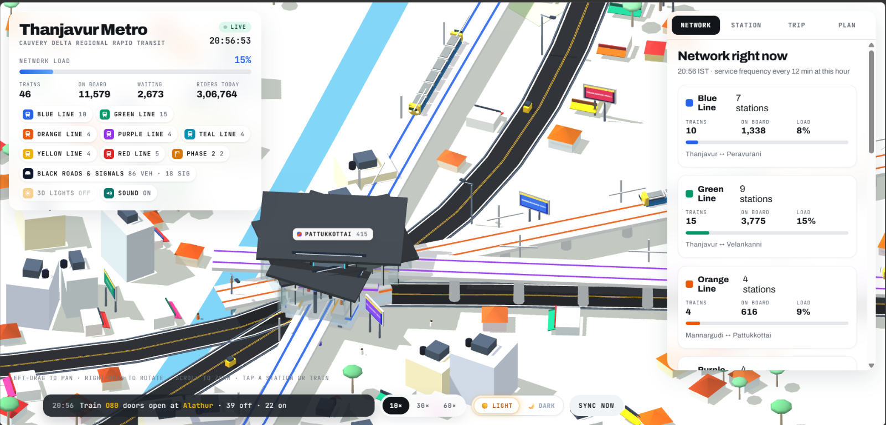

# Cauvery Delta Metro

An interactive Progressive Web App (PWA) for the Cauvery Delta Metro network. Explore the regional rapid-transit network, inspect stations, plan trips, and use the app offline after the application shell has been cached.

The experience is designed around the Thanjavur region and connects:

- Thanjavur
- Kumbakonam
- Mannargudi
- Pattukkottai
- Nagapattinam

## Preview



## Features

- Interactive metro network and live service view
- Trip planner for routes between Delta stations
- Station details and station-focused views
- Light and dark themes
- Responsive mobile-first interface
- Installable PWA experience
- Offline application-shell caching through a service worker
- Tamil-friendly typography and localization-ready interface
- CC0 metro stopping and departure ambience

## Getting started

This project is a static web app and does not require a build step.

1. Clone the repository:

   ```bash
   git clone https://github.com/Sachinkannan127/Metro-App.git
   cd Metro-App
   ```

2. Serve the project from a local HTTP server. For example, with Python:

   ```bash
   python -m http.server 8000
   ```

3. Open [http://localhost:8000](http://localhost:8000) in a browser.

> Opening `index.html` directly from the file system may prevent service-worker and PWA features from working. Use an HTTP server for local development.

## Project structure

```text
.
├── index.html              # Main application UI and client-side logic
├── manifest.json            # PWA metadata, icons, and shortcuts
├── sw.js                    # Service worker and offline cache strategy
├── audio/
│   └── metro-train-cc0.wav  # CC0 metro/train recording
├── icons/
│   ├── icon.svg
│   ├── icon-192.png
│   └── icon-512.png
├── screenshots/
│   └── metro-dashboard.png  # Application dashboard preview
└── scratch/
    └── generate_icons.js    # Utility used to generate application icons
```

## Deployment

Deploy the repository as a static site using any host that serves HTML, CSS, JavaScript, and image files over HTTPS. GitHub Pages, Netlify, Vercel, and Cloudflare Pages are suitable options.

For the best PWA behavior:

- Serve the site over HTTPS in production.
- Keep `manifest.json` and `sw.js` at the site root.
- Preserve the relative paths used by the manifest and service worker.
- Bump `CACHE_NAME` in `sw.js` when releasing changes that must replace cached assets.

## License

No license has been specified for this repository yet.

### Audio source

The recording in `audio/metro-train-cc0.wav` is sourced from [Wikimedia Commons](https://commons.wikimedia.org/wiki/File:Ferrocarril_desde_la_Universidad_de_las_Artes.wav) and is published under the CC0/public-domain dedication.
